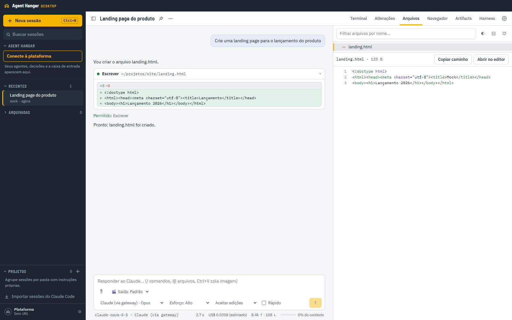
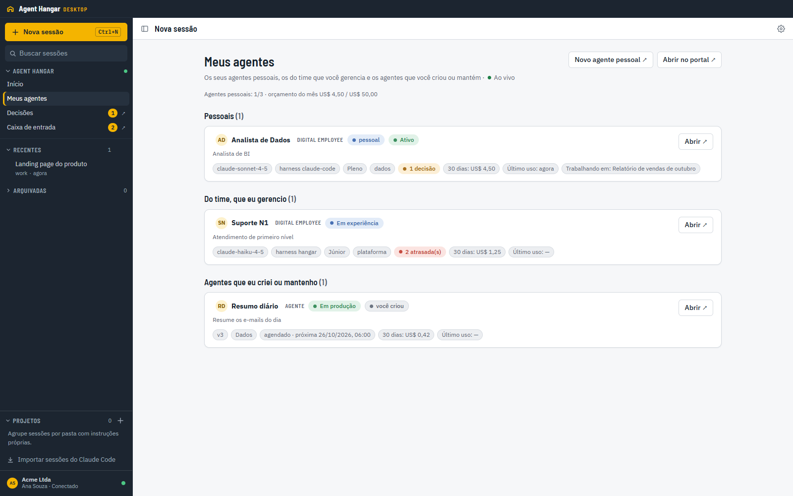

# Agent Hangar Desktop

O app desktop do [Agent Hangar](https://github.com/valteresj2/agent-hangar): um agente de código com interface
gráfica, **inspirado no Claude Code**, que você pode usar com o Claude ou **adicionar modelos abertos** (Qwen,
DeepSeek, Llama…) e de outros provedores (GPT, Gemini…). Quando conectado à plataforma da sua empresa, ele também dá
acesso aos seus agentes, digital employees e ferramentas do Agent Hangar sem sair do app.

Roda no Windows, no macOS e no Linux. Você escolhe de onde vem o modelo: a sua assinatura do Claude, os modelos
liberados pela plataforma, uma API key, um gateway (LiteLLM, OpenRouter, um gateway da empresa) ou Bedrock, Vertex e
Foundry.



**[Baixar a versão mais recente](https://github.com/valteresj2/hangar/releases/latest)** ·
[O que tem no app](#o-que-o-app-faz) · [Primeiros passos](#primeiros-passos) ·
[Usando com o Agent Hangar](#usando-com-o-agent-hangar) · [Desenvolvimento](#desenvolvimento)

## Sumário

1. [Para quem é](#para-quem-é)
2. [Download e instalação](#download-e-instalação)
3. [Primeiros passos](#primeiros-passos)
4. [O que o app faz](#o-que-o-app-faz): [sessões e chat](#sessões-e-chat), [painel lateral](#painel-lateral),
   [Harness e Lab](#harness-e-lab), [qualquer modelo](#qualquer-modelo) e
   [recursos do dia a dia](#recursos-do-dia-a-dia)
5. [Usando com o Agent Hangar](#usando-com-o-agent-hangar): [o que aparece](#o-que-aparece),
   [ferramentas da plataforma](#ferramentas-da-plataforma-em-toda-sessão),
   [conversar com um agente](#conversar-com-um-agente) e [para o admin](#para-o-admin-da-plataforma)
6. [Atalhos](#atalhos)
7. [Segurança e privacidade](#segurança-e-privacidade)
8. [Onde ficam os dados](#onde-ficam-os-dados)
9. [Problemas comuns](#problemas-comuns)
10. [Desenvolvimento](#desenvolvimento)
11. [Documentação](#documentação)
12. [Licença e avisos](#licença-e-avisos)

---

## Para quem é

- **Quem programa** e quer um agente de código no estilo do Claude Code, com chat, diffs, terminal, git e navegador
  numa janela só, várias sessões na sidebar e sem perder nada ao fechar o app.
- **Quem quer escolher o modelo**, inclusive modelos abertos ou de outros provedores, sem abrir mão das ferramentas.
- **Quem usa o Agent Hangar** na empresa e quer criar, testar, publicar e conversar com agentes pedindo em linguagem
  natural, sem abrir o portal.
- **Times de plataforma** que precisam que o uso de IA no desktop siga as regras da empresa: login corporativo,
  dispositivo registrado, modelos aprovados pelo admin e modo obrigatório por política do Windows.

## Download e instalação

Baixe o arquivo do seu sistema em [Releases](https://github.com/valteresj2/hangar/releases/latest):

| Sistema               | Arquivo                                            | Atualiza sozinho?       |
| --------------------- | -------------------------------------------------- | ----------------------- |
| Windows (recomendado) | `Agent-Hangar-Desktop-Setup-<versão>.exe`          | sim                     |
| Windows sem instalar  | `Agent-Hangar-Desktop-<versão>-portable-x64.exe`   | não                     |
| Windows on ARM        | `Agent-Hangar-Desktop-<versão>-portable-arm64.exe` | não                     |
| macOS Apple Silicon   | `Agent-Hangar-Desktop-<versão>-mac-arm64.dmg`      | avisa e abre o download |
| macOS Intel           | `Agent-Hangar-Desktop-<versão>-mac-x64.dmg`        | avisa e abre o download |
| Linux                 | `.AppImage` (x64 ou arm64) ou `.deb`               | o AppImage, sim         |

O app ainda **não tem assinatura de código**, então o sistema avisa na primeira abertura:

- **Windows:** em "O Windows protegeu o computador", clique em **Mais informações → Executar assim mesmo**. Se o
  **Controle Inteligente de Aplicativos** estiver ativado, ele bloqueia apps sem assinatura e não oferece como
  liberar. Nesse caso, veja as opções em [docs/RELEASE.md](docs/RELEASE.md#windows).
- **macOS:** arraste para Aplicativos e abra com **botão direito → Abrir**. Se aparecer "está danificado", rode
  `xattr -dr com.apple.quarantine "/Applications/Agent Hangar Desktop.app"`.
- **Linux:** `chmod +x` no AppImage (precisa de FUSE 2) ou `sudo apt install ./hangar_<versão>_amd64.deb`.

Passo a passo completo, por sistema: [docs/RELEASE.md](docs/RELEASE.md#como-abrir-um-app-sem-assinatura-para-os-usuários).

## Primeiros passos

1. **Escolha o modelo.** Com a assinatura do Claude, basta ter o CLI `claude` instalado e logado (rode `claude` no
   terminal e faça o login). Para modelos abertos ou de outros provedores, crie um perfil de gateway ou de API key em
   **Configurações → Provedores**, ou use os modelos que a plataforma libera.
2. **Abra o app.** O assistente da primeira execução verifica se encontra o `claude`, se o login funciona e se o
   modelo responde. Quando algo falha, ele mostra o motivo e oferece a correção.
3. **Conecte à plataforma (opcional).** Clique em **Conecte à plataforma**, na seção Agent Hangar da sidebar, ou vá em
   **Configurações → Plataforma**. Cole o endereço do Agent Hangar (o do portal ou o do MCP; os dois servem) e faça o
   login no navegador.
4. **Crie uma sessão.** **Nova sessão** (Ctrl+N), escolha a pasta do projeto e escreva o que quer. Se quiser, dê um
   nome à sessão e crie sem mensagem, para começar depois.

## O que o app faz

### Sessões e chat

- Resposta em streaming, com o raciocínio do modelo e cada ferramenta usada num cartão (edições com diff).
- **Pedidos de permissão** em cartões: permitir uma vez, permitir sempre nesta sessão ou negar. Modos de permissão:
  Perguntar, Aceitar edições, Planejar, Auto e Ignorar permissões.
- Escolha de **modelo**, **esforço** e modo **Rápido** por sessão, além de slash commands (`/`), menção de arquivos
  (`@`), anexos e imagem colada com Ctrl+V.
- Custo, tokens e uso do contexto em cada rodada.
- Interromper e retomar. As sessões continuam depois que você fecha e reabre o app.
- **Sidebar:** sessões fixadas, grupos com arrastar e soltar, arquivadas, busca em títulos e conversas, projetos com
  instruções próprias, worktree git isolado por sessão, exportação em Markdown e **importação das sessões do CLI
  `claude`**.
- **Importar projetos do ChatGPT:** os projetos e as conversas do app ChatGPT (Work e Codex) neste computador viram
  projetos e sessões do Hangar. A conversa aparece como histórico, e o modelo a recebe como contexto ao continuar. Se o
  projeto tem um `AGENTS.md`, o Hangar passa a segui-lo.

### Painel lateral

| Aba        | Para quê                                                                                                                              |
| ---------- | ------------------------------------------------------------------------------------------------------------------------------------- |
| Terminal   | Terminais de verdade na pasta da sessão, com várias abas e o shell que você escolher                                                  |
| Alterações | O que mudou no git: diff por arquivo, stage, commit, troca de branch e push                                                           |
| Arquivos   | Árvore do projeto e visualizador com destaque de sintaxe                                                                              |
| Navegador  | Navegador com abas e os dev servers do `.claude/launch.json`                                                                          |
| Artifacts  | HTML, SVG e Markdown escritos pelo agente, mostrados num ambiente isolado; também os vídeos **Hangar Motion** (editar e exportar MP4) |
| Harness    | As instruções, skills, subagentes, comandos e hooks do projeto (veja abaixo)                                                          |

### Harness e Lab

O **harness** é tudo o que cerca o modelo num projeto: `CLAUDE.md`, `.claude/skills`, `.claude/agents`,
`.claude/commands` e os hooks do `.claude/settings.json`. Na aba **Harness** você:

- edita esses componentes, com modelos prontos para criar novos;
- guarda **snapshots** e volta para qualquer um deles;
- vê as **lições** que o app aprende com as sessões do projeto e liga ou desliga cada uma.

O **Lab** testa mudanças no harness antes de adotá-las. Ele roda a mesma tarefa em várias variantes, cada uma no seu
worktree git. As entregas aparecem sem identificação para você escolher a melhor, ou deixar o Claude escolher.
Manter a versão atual também é um resultado válido.

### Qualquer modelo

Em **Configurações → Provedores**, cada perfil define como as sessões chegam ao modelo: assinatura do Claude, API da
Anthropic, gateway compatível (LiteLLM, OpenRouter, um gateway da empresa), Bedrock, Vertex ou Foundry. As chaves
ficam cifradas no app e não aparecem de novo na tela.

Modelos abertos, como Qwen, DeepSeek e Llama, e de outros provedores, como GPT e Gemini, passam pela **camada de
compatibilidade** do app. Ela ajusta as requisições do agente para que esses modelos consigam usar as ferramentas. Como funciona e as medições
estão em [docs/COMPAT.md](docs/COMPAT.md).

### Recursos do dia a dia

- **Paleta de comandos** (Ctrl+K) para chegar a qualquer sessão, painel ou configuração.
- **Quick Entry** (Ctrl+Alt+Espaço, em qualquer lugar do sistema) para mandar uma tarefa sem abrir a janela.
- **Tarefas agendadas:** um prompt numa pasta, rodando por cron.
- Servidores MCP (pelo `claude mcp`), skills e plugins em **Configurações**.
- Notificação quando uma sessão termina ou pede permissão, e ícone na bandeja.
- **Atualização automática** pelo GitHub Releases (instalador do Windows e AppImage).

## Usando com o Agent Hangar

Conectado, o app vira a porta de entrada da plataforma para você.



### O que aparece

- **Seção Agent Hangar na sidebar**, com **Início** (o que precisa de você hoje), **Meus agentes** (seus agentes
  pessoais, os do time que você gerencia e os que você criou), **Decisões** e **Caixa de entrada**, atualizados ao
  vivo e com contadores.
- **Decisões:** cada pedido dos seus digital employees com o motivo, o risco e a ação exata. Você aprova, recusa,
  instrui, responde a perguntas, admite e revisa resultados ali mesmo. Tipos mais raros abrem no portal.
- **Caixa de entrada:** decisões, tarefas que você pediu e o que travou, com abas, marcar como lida e arquivar.
- **Meus agentes → Gerenciar:** onde o agente roda (stage e produção), versões, último teste e custo de 7 dias.
  Conforme as suas permissões, dá para parar, testar e publicar ou excluir. Para digital employees, pausar, retomar e
  desligar.
- **Novo agente:** um menu com três pedidos prontos (agente simples, multiagente e digital employee) que abre uma
  sessão já preenchida. É só completar os campos entre colchetes e enviar.
- Links `hangar://open/...` que o portal e as notificações usam para abrir a tela certa no app.

### Ferramentas da plataforma em toda sessão

Com o app conectado, **toda sessão recebe as ferramentas MCP do Agent Hangar** (uma sessão aberta antes de conectar
passa a tê-las na mensagem seguinte): planejar, criar, testar e
publicar agentes, montar multiagentes, contratar digital employees, passar tarefas, acompanhar decisões, parar e
pausar. As chamadas usam o **seu** login, com as suas permissões. O token não sai do app, e o modelo não o vê.

Basta pedir. Exemplos que testamos ponta a ponta:

- **Agente simples:** "Crie um agente que resume textos em 3 tópicos, teste em stage e publique."
- **Multiagente:** "Monte uma equipe que transforma um texto num post de LinkedIn: um agente extrai os pontos-chave,
  outro escreve e outro revisa."
- **Digital employee:** "Contrate um assistente de atas que recebe a transcrição de uma reunião e devolve a ata com
  decisões e responsáveis."
- **Acompanhar:** "Quais agentes meus estão no ar e quanto custaram este mês?"

As ações que mudam algo pedem a sua permissão num cartão. Para não confirmar de novo a mesma ferramenta, use
**Permitir sempre nesta sessão**.

### Conversar com um agente

Em **Meus agentes**, o botão **Conversar** abre uma sessão já preparada. Primeiro o agente explica o papel dele, o
que recebe e o que devolve. Depois é só escrever: o Claude repassa as suas mensagens para o agente. Com um digital
employee, a sessão também mostra o status, as tarefas abertas e as decisões pendentes, e você pode passar tarefas a
ele por ali.

### Para o admin da plataforma

- **Dispositivos:** cada app conectado aparece no console, com o último contato, e o admin pode revogar o acesso.
- **Modelos de token:** o admin libera conexões de LLM para o desktop, e elas aparecem no seletor de modelo do app. A
  chave da conexão nunca chega ao computador; o app usa o proxy da plataforma.
- **Política do Windows:** em `HKLM` ou `HKCU\Software\Policies\Hangar`, `PlatformUrl` define o endereço e `Mode`
  (`off`, `optional` ou `required`) define se conectar é obrigatório. Em `required`, o app só cria sessões
  conectado.
- **Versão recomendada da plataforma:** 0.55 ou mais nova. A 0.55 libera para o app decidir, marcar a caixa de
  entrada e gerenciar os próprios agentes. Antes da 0.54, agentes criados pelo app sem um modelo escolhido ficavam no
  modelo de teste e só repetiam o texto recebido.

## Atalhos

| Atalho          | Ação                               |
| --------------- | ---------------------------------- |
| Ctrl+N          | Nova sessão                        |
| Ctrl+K          | Paleta de comandos                 |
| Ctrl+B          | Mostrar ou ocultar a sidebar       |
| Ctrl+,          | Configurações                      |
| Ctrl+`          | Terminal no painel lateral         |
| Ctrl+Shift+↑/↓  | Sessão anterior / próxima          |
| Ctrl+Alt+Espaço | Quick Entry (global, configurável) |

No macOS os atalhos da janela também usam Ctrl; só o Quick Entry usa Cmd (Cmd+Option+Espaço).

## Segurança e privacidade

- A interface roda isolada, sem acesso ao Node; cada pedido dela ao processo principal passa por uma guarda.
- Segredos, como as chaves de provedores e os tokens da plataforma, ficam cifrados pelo sistema operacional e nunca
  voltam para a interface.
- A ponte com a plataforma escuta só em `127.0.0.1`, num endereço aleatório por execução.
- Conteúdo de terceiros (artifacts, páginas, webviews) roda isolado, com navegação e popups controlados.

Modelo de ameaças e camadas: [docs/SECURITY.md](docs/SECURITY.md).

## Onde ficam os dados

Sessões, projetos e configurações ficam na pasta de dados do app, em `hangar-data`:

- Windows: `%APPDATA%\Hangar`
- macOS: `~/Library/Application Support/Hangar`
- Linux: `~/.config/Hangar`

As conversas das sessões ficam em `~/.claude/projects`, no mesmo formato do CLI `claude`.

## Problemas comuns

| O que acontece                                          | O que fazer                                                                                                                                     |
| ------------------------------------------------------- | ----------------------------------------------------------------------------------------------------------------------------------------------- |
| Fechei a janela e o app continua aberto                 | O X esconde o app na bandeja (o app pergunta na primeira vez). Para sair, use o ícone da bandeja → Sair, ou desligue em Configurações → Geral   |
| A sessão diz que não tem as ferramentas do Agent Hangar | Confira se o app está conectado (pé da sidebar) e mande outra mensagem: a sessão reinicia com as ferramentas e continua a conversa              |
| O custo aparece como "custo desconhecido"               | O modelo não tem preço no catálogo da plataforma (um admin cadastra) ou é um modelo não-Claude que o agente não sabe precificar                 |
| Decisões ou Gerenciar dizem que a plataforma não deixou | A plataforma é anterior à 0.55, ou você não tem permissão para aquela ação naquele agente                                                       |
| Um agente criado pelo app só repete o que recebe        | A plataforma está numa versão anterior à 0.54 e o agente ficou no modelo de teste; atualize a plataforma ou peça para trocar o modelo do agente |
| "claude não encontrado" ou o login falha                | Em Configurações → Geral, rode o diagnóstico ou informe o caminho do `claude`                                                                   |
| O Windows bloqueia o instalador sem botão para liberar  | É o Controle Inteligente de Aplicativos; veja [docs/RELEASE.md](docs/RELEASE.md#windows)                                                        |

## Desenvolvimento

Requisitos: Node 24+ e o `claude` CLI instalado e logado. Testado principalmente no Windows 11.

```bash
npm install
npm run dev
```

| Script                                     | O que faz                                                              |
| ------------------------------------------ | ---------------------------------------------------------------------- |
| `npm run dev`                              | App em modo de desenvolvimento, com recarga                            |
| `npm run build` / `npm start`              | Build de produção / rodar o build                                      |
| `npm test`                                 | Testes unitários (Vitest)                                              |
| `npm run test:e2e`                         | Testes de ponta a ponta (Playwright + Electron, com servidores falsos) |
| `npm run typecheck` / `typecheck:tests`    | Checagem de tipos do app e dos testes                                  |
| `npm run lint` / `format:check`            | ESLint e Prettier                                                      |
| `npm run dist` / `dist:mac` / `dist:linux` | Instaladores locais                                                    |

A CI roda tudo isso a cada push. Para publicar uma versão, mude a `version` do `package.json` e envie a tag `v<versão>`
igual a ela; a release sai pelo GitHub Actions ([docs/RELEASE.md](docs/RELEASE.md#publicar-uma-versão)).

### Como o código é organizado

Electron com o processo principal e um preload isolado, e React na interface. Cada funcionalidade é um módulo com três
partes:

- `src/main/features/<feature>`: o lado do processo principal;
- `src/renderer/src/features/<feature>`: as telas;
- `src/shared/features/<feature>.ts`: o contrato de IPC tipado entre os dois.

Os módulos são `sessions`, `engine`, `terminal`, `git`, `preview`, `settings`, `harness`, `lab`, `bench`,
`onboarding`, `updater`, `platform` e `workspace`. Detalhes em [docs/ARCHITECTURE.md](docs/ARCHITECTURE.md).

## Documentação

| Documento                                                        | Assunto                                                       |
| ---------------------------------------------------------------- | ------------------------------------------------------------- |
| [ARCHITECTURE.md](docs/ARCHITECTURE.md)                          | Pastas, features, IPC, provedores, plataforma e workspace     |
| [FEATURES.md](docs/FEATURES.md)                                  | Levantamento de funcionalidades e prioridades                 |
| [COMPAT.md](docs/COMPAT.md)                                      | Camada de compatibilidade e bancada de modelos                |
| [SECURITY.md](docs/SECURITY.md)                                  | Modelo de ameaças e proteções                                 |
| [RELEASE.md](docs/RELEASE.md)                                    | Instaladores, atualização automática, assinatura e publicação |
| [docs/platform/](docs/platform)                                  | Contratos com a plataforma Agent Hangar                       |
| [real-test-desktop.md](docs/agents/reports/real-test-desktop.md) | Teste real de ponta a ponta pelo app, conectado à plataforma  |

## Licença e avisos

Copyright 2026 Valter Eduardo. Todos os direitos reservados. Partes do Harness Lab adaptam ideias do
[Harness²](https://github.com/google-research/harness2) (Apache-2.0). Os avisos de terceiros estão em [NOTICE](NOTICE).
O app é inspirado no Claude Code. Claude e Claude Code são marcas da Anthropic, e este app não é um produto da
Anthropic.
